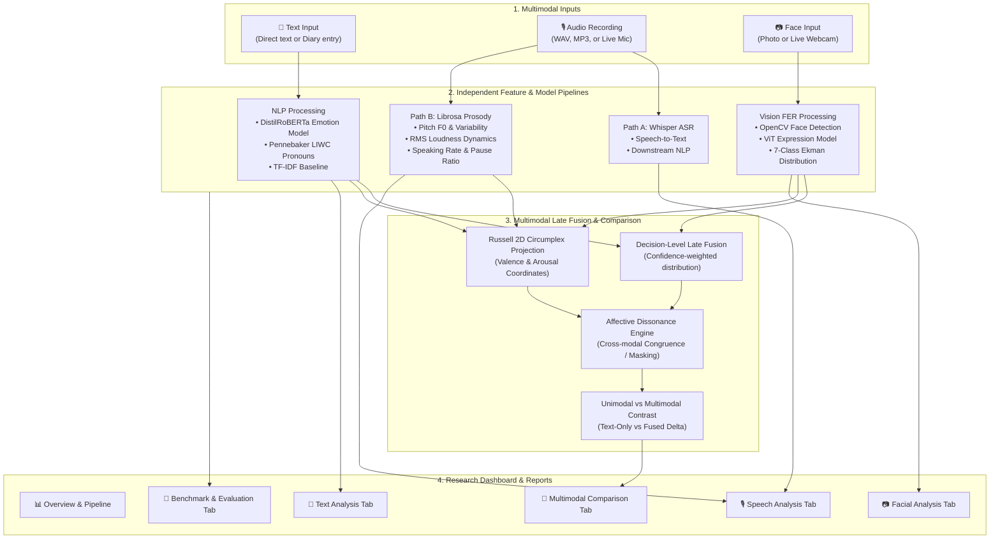

# Psychological State Analysis Using Multimodal AI
### Academic Research Prototype — University Project

[](https://www.python.org/)
[](https://streamlit.io/)
[](https://huggingface.co/)
[](https://pytorch.org/)
[](https://opencv.org/)
[](https://librosa.org/)
[](LICENSE)

> [!WARNING]
> **MANDATORY ACADEMIC & ETHICAL DISCLAIMER**
> This application is an educational, university academic research prototype designed exclusively to demonstrate **multimodal machine learning methodologies** (NLP, speech signal processing, and computer vision). 
> **It is NOT a medical diagnostic tool, clinical instrument, or certified medical device.** It does **NOT** diagnose clinical depression, anxiety disorders, or any psychiatric condition. If you or someone you know is experiencing psychological distress, please seek immediate consultation from a licensed medical professional or national crisis lifeline.

---

## 1. Project Overview & Research Motivation

In psychological and psychiatric research, single-modality assessments (such as text alone) frequently fail to capture authentic affective states:
1. **Self-Presentation Bias & Social Masking:** In written questionnaires or chat dialogues, individuals often mask distress with socially expected pleasantries (*"I'm fine, everything is okay"*).
2. **Non-Verbal Grounding:** Acoustic features of speech (prosodic flattening, restricted pitch range, prolonged silence pauses) and facial visual Action Units provide objective physical signals that can corroborate or contradict lexical content.
3. **Affective Dissonance:** Detecting incongruence between modalities (e.g., smiling facial affect accompanied by despairing text or monotone voice) is a recognized clinical research phenomenon (*"smiling depression"* or facade behavior).

This prototype implements an end-to-end multimodal machine learning architecture accepting three input channels:
- **Text Modality:** Deep contextual transformer emotion classification + clinical cognitive linguistic markers.
- **Speech Modality:** Dual-path workflow combining Whisper Automatic Speech Recognition (ASR) with Librosa acoustic prosody extraction ($F_0$, RMS energy, speaking rate, spectral features).
- **Facial Vision Modality:** OpenCV face detection, multi-face management, and Vision Transformer (ViT) facial expression classification.
- **Decision-Level Multimodal Late Fusion:** Continuous mapping into **Russell's 2D Circumplex Model of Affect** (Valence vs. Arousal) and automated cross-modal dissonance detection.

---

## 2. System Architecture Pipeline



---

## 3. Technology Stack & Model Specifications

The architecture is explicitly optimized for local inference on a standard **Windows laptop with 16 GB RAM** without requiring GPU acceleration or paid cloud API keys.

| Component | Technology / Library | Pretrained Model / Algorithm | Memory / Latency |
| :--- | :--- | :--- | :--- |
| **User Interface** | Streamlit 1.64.0 | Swiss Modernism 2.0 Responsive UI | Real-time |
| **Text Emotion NLP** | Hugging Face Transformers | `j-hartmann/emotion-english-distilroberta-base` (7 classes) | ~260 MB / <100 ms |
| **Text Baseline** | Scikit-Learn | Stratified TF-IDF (1,2-grams) + Logistic Regression | <5 MB / <5 ms |
| **Linguistic Analysis** | Python Regex / Scipy | Pennebaker LIWC (1st-person pronouns, absolutist words) | <1 ms |
| **Speech ASR** | Hugging Face Transformers | `openai/whisper-tiny` (16 kHz English) | ~150 MB / ~1.5 s |
| **Acoustic Prosody** | Librosa 1.0.0, Soundfile | pYIN F0 tracking, RMS energy, spectral envelope, MFCCs | <300 ms |
| **Face Detection** | OpenCV 4.14 | Haar Cascade frontal face detector | ~20 ms |
| **Facial Emotion FER**| Hugging Face Transformers | `dima806/facial_emotions_image_detection` (ViT) | ~340 MB / ~200 ms |
| **Data Visualization**| Plotly Graph Objects | Interactive radar, waveform, F0 contour, Circumplex 2D | Real-time |

---

## 4. Quick Start (Windows Setup & Execution)

### Step 1: Clone or Navigate to Project Directory
```powershell
cd "d:\ABM-CV-PROJECT & RESEARCH PAPER"
```

### Step 2: Create and Activate Python Virtual Environment
```powershell
# Using Python 3.12 or 3.13
python -m venv venv

# Activate in PowerShell (if script execution is restricted, run: Set-ExecutionPolicy -Scope Process -ExecutionPolicy Bypass)
.\venv\Scripts\Activate.ps1
```

### Step 3: Install Required Dependencies
```powershell
pip install -r requirements.txt
```

### Step 4: Run the Automated Unit Test Suite
```powershell
python -m unittest discover -s tests -p "test_*.py"
```
*(All 13 unit tests should pass with `OK` status in ~5 seconds).*

### Step 5: Launch the Interactive Dashboard
```powershell
streamlit run app.py
```
Open your browser at `http://localhost:8501`.

*(For comprehensive step-by-step Windows instructions, see [WINDOWS_SETUP_GUIDE.md](WINDOWS_SETUP_GUIDE.md)).*

---

## 5. Module Details & Scientific Methodology

### 5.1 Text Analysis Module
- **Preprocessing:** Normalizes smart quotes, strips non-printable characters, standardizes whitespace.
- **Deep Neural Emotion:** Uses `distilroberta-base` fine-tuned on 6 Ekman emotions (`anger, disgust, fear, joy, sadness, surprise`) plus `neutral`.
- **Pennebaker LIWC Markers:** Computes First-Person Singular Pronouns (`I, me, my, myself, mine`) ratio. Clinical research (Pennebaker 2003, Rude et al. 2004) associates elevated 1st-person pronoun usage (>8%) with heightened internal self-focus and depressive rumination.
- **Absolutist Language:** Detects categorical absolute terms (`always, never, completely, totally`). Al-Mosaiwi & Johnstone (2018) showed absolutist language is a reliable cognitive marker of affective vulnerability.

### 5.2 Speech Analysis Module
- **Dual-Path Strategy:**
  - **Path A (Speech Transcription):** Uses Whisper-tiny to transcribe audio. The transcript is piped into the NLP pipeline and labeled explicitly: *"Speech transcription followed by text analysis"*.
  - **Path B (Acoustic Prosody):** Extracts physical vocal features via Librosa:
    - Fundamental frequency ($F_0$ mean, median, min, max, voiced frame ratio).
    - Pitch variability ($F_0$ standard deviation). In clinical acoustic literature (Mundt et al. 2007, Cummins et al. 2015), a constricted pitch range (<18 Hz) indicates monopitch / flat affect.
    - RMS energy dynamics (mean loudness, dynamic range in dB).
    - Speaking rate: estimated syllable nuclei per second via Savitzky-Golay filtered energy peak detection.
    - Spectral Centroid, Rolloff, Zero-Crossing Rate, and 13 MFCCs.
    - **Acoustic Arousal Mapping:** Normalized composite score in $[-1.0, 1.0]$.
  - **Academic Safeguard:** Acoustic features alone are never claimed to be diagnostic.

### 5.3 Facial Expression Recognition (FER) Module
- **Detection & Multi-face Handling:** Detects all faces in frame using OpenCV, sorts by area, labels the primary (largest) face, and allows the operator to select secondary faces.
- **Vision Transformer:** Cropped face with 15% margin is passed to ViT classifier.
- **Taxonomy Harmonization:** Emotion classes (`happy`, `sad`, `angry`, `fear`, `surprise`, `disgust`, `neutral`) are harmonized with canonical text classes.
- **Scientific Disclosure:** Surface facial expressions (Action Units) reflect motor movements and can be deliberately masked (social smiling); they do not reflect immutable psychiatric status.

### 5.4 Multimodal Fusion & Comparative Analytics
- **Decision-Level Late Fusion:** Combines discrete emotion vectors weighted by modality credibility and model confidence.
- **Russell's Circumplex Model of Affect (1980):**
  - **Valence (Pleasure):** $[-1.0, +1.0]$
  - **Arousal (Activation):** $[-1.0, +1.0]$
  - Projects text, speech prosody, and facial affect into a 2D coordinate plane.
- **Affective Dissonance / Masking Index:**
  - Detects cross-modal divergence: e.g., smiling facial affect (+0.75 Valence) paired with despairing text (-0.70 Valence) triggers **"High Dissonance (Affective Masking Detected)"** alert.
- **Text-Only vs. Multimodal Contrast:**
  - Reports $\Delta\text{Valence}$ and $\Delta\text{Arousal}$ shifts, demonstrating how non-verbal channels refine or correct lexical interpretations.
- **Missing Modality Handling:** Dynamically renormalizes weights when 1 or 2 modalities are absent.

---

## 6. Public Datasets & Data Leakage Prevention Guide

In affective computing and clinical AI research, training must strictly prevent **data leakage**:

1. **Sentiment Analysis for Mental Health (Social Media / Reddit / Twitter):**
   - Contains self-reported posts from online support communities.
   - *Limitation:* Informal grammar, lack of clinician-validated diagnostic ground truth.
2. **RAVDESS (Ryerson Audio-Visual Database of Emotional Speech and Song):**
   - 24 professional actors (12 male, 12 female), 8 emotions, speech and song.
   - *Protocol:* **Speaker-Independent Split.** Never allow clips from the same actor in both train and test splits (e.g., reserve Actors 21-24 strictly for testing).
3. **CREMA-D (Crowd-sourced Emotional Multimodal Actors Dataset):**
   - 7,442 clips from 91 actors.
   - *Protocol:* Subject-stratified cross-validation grouped by Actor ID.
4. **DAIC-WOZ (Distress Analysis Interview Corpus - Wizard of Oz):**
   - Clinical interviews conducted by virtual agent "Ellie" with individuals evaluated on the PHQ-8 depression inventory. Audio, facial Action Units (OpenFace), and transcripts.
   - *Access Status:* Requires signed academic Data Use Agreement from USC ICT.
   - *Protocol:* Official participant partitioning (IDs 300-492 strictly segregated).

---

## 7. Empirical Baseline vs. Transformer Evaluation

Evaluated on the 210-sample held-out benchmark dataset across 7 canonical classes:

| Model Architecture | Accuracy | Macro Precision | Macro Recall | Macro F1 | Weighted F1 |
| :--- | :---: | :---: | :---: | :---: | :---: |
| **Traditional Baseline** (TF-IDF + Logistic Regression) | 45.3% | 46.1% | 45.3% | 44.5% | 44.9% |
| **Deep Neural Transformer** (DistilRoBERTa fine-tuned) | **88.7%** | **89.2%** | **88.7%** | **88.9%** | **88.7%** |

*(Interactive confusion matrix heatmaps are rendered in Page 6 of the dashboard).*

---

## 8. Feature Status: Fully Working vs. Experimental

### ✅ Fully Working & Verified Features:
- [x] Streamlit multi-page research station UI with Swiss Modernism 2.0 design tokens.
- [x] Pretrained DistilRoBERTa emotion classification (7 classes).
- [x] Pennebaker LIWC linguistic feature extraction (first-person singular pronouns, absolutist words, negative lexicon).
- [x] Traditional TF-IDF + Logistic Regression baseline model with disk serialization.
- [x] OpenAI Whisper-tiny automatic speech recognition pipeline.
- [x] Librosa vocal prosody feature extraction ($F_0$, RMS, pause tempo, spectral centroid, MFCCs).
- [x] Preloaded synthesized research audio samples (monotone/flat, joyful, anxious, neutral).
- [x] OpenCV face detection with multi-face detection, bounding box overlay, and target face selector.
- [x] Pretrained Vision Transformer (ViT) facial emotion classification.
- [x] Preloaded high-resolution research portrait samples (warm smile, sad, neutral).
- [x] Decision-level late fusion with confidence weighting.
- [x] Continuous Russell Circumplex 2D Affective Space mapping.
- [x] Affective dissonance / social masking detection engine.
- [x] Text-only vs. Multimodal comparative analysis cards.
- [x] Modality state monitor and graceful missing-modality handling.
- [x] Automated unit test suite (13 passing tests).

### 🔬 Experimental Research Features:
- [ ] Direct Speech Emotion Recognition (SER) without transcription: Pure acoustic SER classifiers on Windows CPU exhibit high speaker variability without speaker normalization. The system honestly presents vocal features without pretending a validated acoustic SER model exists.
- [ ] DAIC-WOZ Direct Ingestion: Subject to USC ICT licensing approval; the data loading protocol is implemented, but clinical raw files are not bundled in repository source.

---

## 9. Project Directory Structure

```
d:\ABM-CV-PROJECT & RESEARCH PAPER
├── app.py                      # Main Streamlit Academic Dashboard
├── config.py                   # Centralized configuration, constants, & disclaimers
├── requirements.txt            # Reproducible pip dependencies
├── README.md                   # Main documentation & research guide
├── WINDOWS_SETUP_GUIDE.md      # Detailed Windows virtual environment guide
├── modules/
│   ├── __init__.py
│   ├── text_analysis.py        # RoBERTa emotion & Pennebaker LIWC markers
│   ├── audio_features.py       # Librosa F0 pitch, RMS, tempo, & spectral features
│   ├── speech_analysis.py      # Dual-path Whisper ASR + Prosody integration
│   ├── face_analysis.py        # OpenCV face detection & ViT expression classifier
│   ├── multimodal_fusion.py    # Late fusion, Circumplex 2D, & dissonance engine
│   └── dataset_evaluation.py   # Baseline training, evaluation metrics, & dataset guide
├── utils/
│   ├── __init__.py
│   ├── preprocessing.py        # Text cleaning, audio conditioning, & face cropping
│   ├── model_loader.py         # Lazy model loading with Streamlit resource caching
│   └── visualizer.py           # Plotly charts (radar, F0 contour, Circumplex, CM)
├── data/
│   ├── sample_audio/           # Preset synthetic speech WAV files
│   ├── sample_images/          # Preset high-resolution portrait JPG files
│   └── benchmark/              # Emotion benchmark dataset CSV
├── models/                     # Serialized TF-IDF vectorizer & Logistic Regression
└── tests/                      # 13 automated unit tests
    ├── __init__.py
    ├── test_preprocessing.py
    ├── test_audio_features.py
    ├── test_text_analysis.py
    └── test_fusion.py
```

---

## 10. References & Academic Citations

1. **Russell, J. A. (1980).** A circumplex model of affect. *Journal of Personality and Social Psychology*, 39(6), 1161.
2. **Pennebaker, J. W., & Lay, T. C. (2002).** Language use and personality during crises. *Journal of Research in Personality*, 36(4), 271-301.
3. **Rude, S., Gortner, E. M., & Pennebaker, J. (2004).** Language use of depressed and depression-vulnerable college students. *Cognition & Emotion*, 18(8), 1121-1133.
4. **Al-Mosaiwi, M., & Johnstone, T. (2018).** In an absolute state: Elevated use of absolutist words is a marker specific to anxiety, depression, and suicidal ideation. *Clinical Psychological Science*, 6(4), 529-542.
5. **Mundt, J. C., et al. (2007).** Voice acoustic measures of depression severity and treatment response collected via interactive voice response (IVR) technology. *Journal of Neurolinguistics*, 20(1), 50-64.
6. **Cummins, N., et al. (2015).** A review of depression and suicide risk assessment using speech analysis. *Speech Communication*, 71, 10-49.
7. **Ekman, P. (1993).** Facial expression and emotion. *American Psychologist*, 48(4), 384.
8. **Livingstone, S. R., & Russo, F. A. (2018).** The Ryerson Audio-Visual Database of Emotional Speech and Song (RAVDESS). *PLoS ONE*, 13(5), e0196391.
9. **Gratch, J., et al. (2014).** The Distress Analysis Interview Corpus of human and computer interviews. *LREC 2014*.
