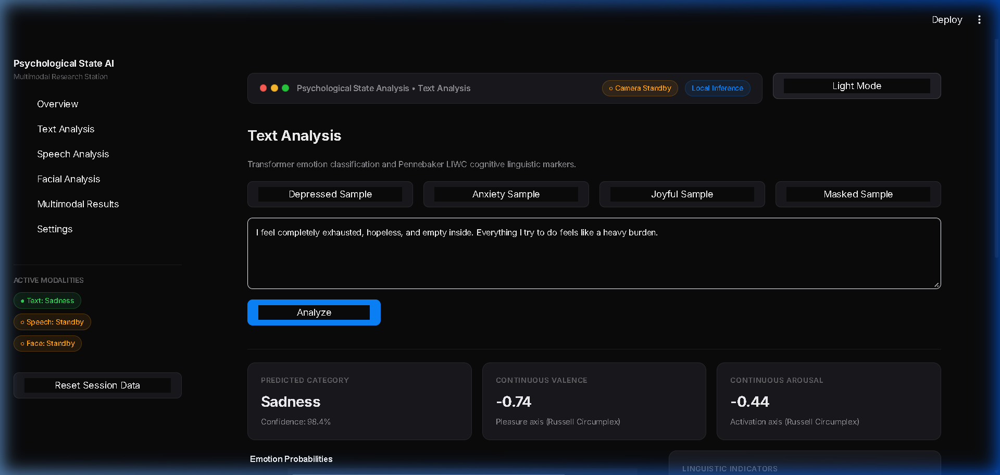
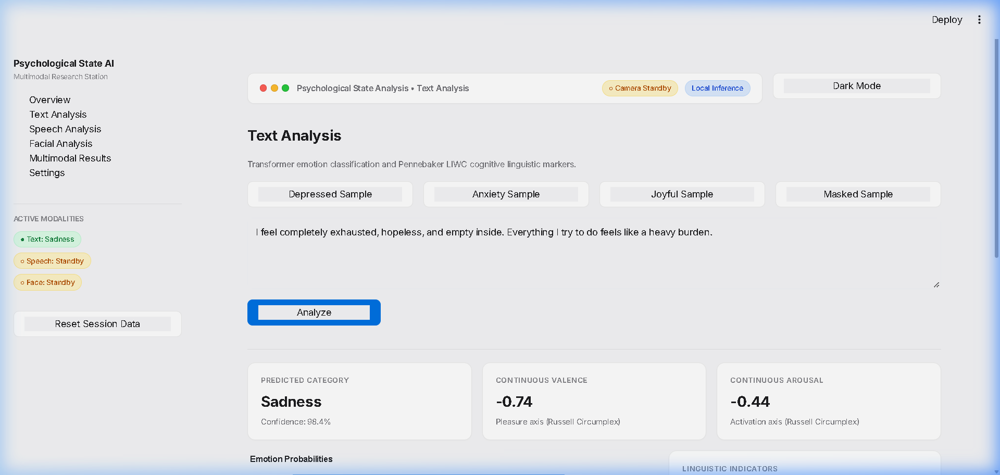
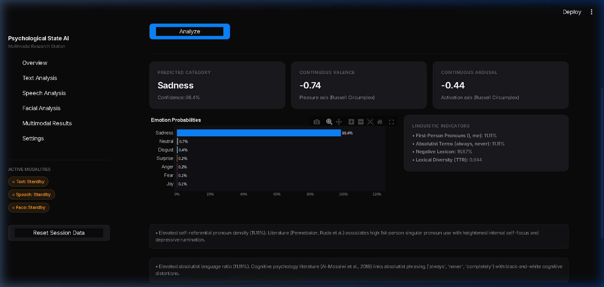
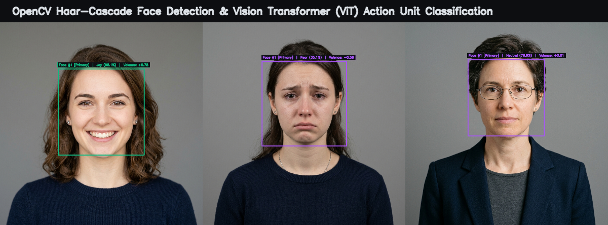
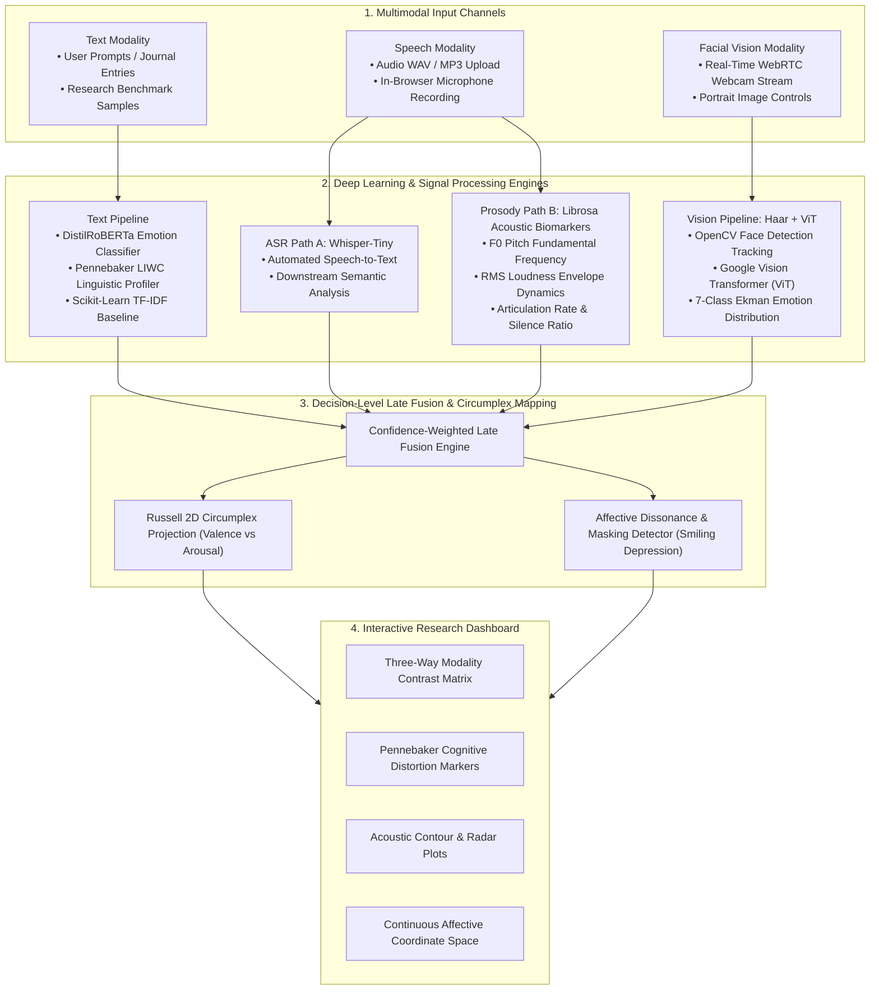
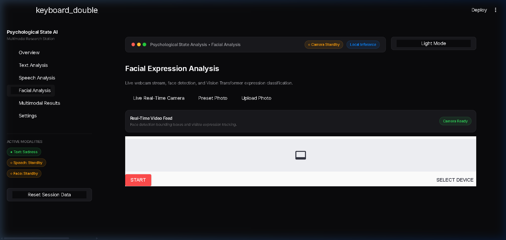

# Psychological State Analysis Using Multimodal AI
### macOS & Linear Inspired AI Research Station — University Academic Prototype

[](https://thebilalbutt-psychological-state-analysis-multimodal-app-uxhkuk.streamlit.app/)
[](https://github.com/TheBilalButt/psychological-state-analysis-multimodal-ai)
[](https://www.python.org/)
[](https://pytorch.org/)
[](https://huggingface.co/)
[](https://opencv.org/)
[](https://librosa.org/)
[](LICENSE)

---

## Live Interactive Deployment

Experience the fully functional research platform live in your browser:

### 🔗 **[https://thebilalbutt-psychological-state-analysis-multimodal-app-uxhkuk.streamlit.app/](https://thebilalbutt-psychological-state-analysis-multimodal-app-uxhkuk.streamlit.app/)**

> [!NOTE]
> All model inferences run in memory with complete client-side data privacy. No webcam video, audio recordings, or text entries are permanently stored on any server.

---

## User Interface & Design Philosophy

The application interface is styled after **native macOS design language, Apple Health, and Linear**:
- **Typography:** Apple system font stack (`-apple-system`, `BlinkMacSystemFont`, `SF Pro Display`, `Inter`).
- **Dual Themes:** Refined near-black macOS dark theme by default, with a one-click working Apple light theme toggle.
- **Chrome:** macOS window controls (traffic lights), live camera status pill, and local inference indicators.
- **Clutter-Free:** Zero emojis, clean hairline borders (`#23272F`), modest card corner radii, and publication-ready Plotly visualizations.

### macOS Dark Theme (Default)


### Apple Light Theme Switch


### Deep Linguistic Indicators & Pennebaker LIWC Markers


### Real-Time Facial Recognition & Action Unit Bounding Boxes


---

## System Architecture Pipeline



---

## Multimodal Analysis Engines

### 1. Linguistic Modality (Text Analysis)
* **Contextual Emotion Model:** `j-hartmann/emotion-english-distilroberta-base` fine-tuned on 6 Ekman emotion classes + Neutral.
* **Pennebaker LIWC Cognitive Biomarkers:**
  - *First-Person Pronouns ($I$, $me$, $my$):* Quantifies internal self-referential focus and depressive rumination (Pennebaker & Rude et al.).
  - *Absolutist Terms ($always$, $never$, $completely$):* Tracks black-and-white cognitive distortions (Al-Mosaiwi et al., 2018).
  - *Negative Lexicon Density:* Ratio of negative valence words relative to overall token count.
  - *Type-Token Ratio (TTR):* Lexical diversity and vocabulary richness.
* **Continuous Affect Coordinates:** Mapped onto Russell's Circumplex:
  $$\text{Valence} \in [-1.0, +1.0], \quad \text{Arousal} \in [-1.0, +1.0]$$

### 2. Acoustic Modality (Speech & Vocal Prosody)
* **Path A (Transcription):** `openai/whisper-tiny` ASR produces exact textual transcripts from speech.
* **Path B (Vocal Prosody Biomarkers):**
  - *Fundamental Frequency ($F_0$ Pitch):* Uses Librosa parabolic-interpolated autocorrelation pitch tracking. Depressive speech often correlates with pitch flattening and restricted pitch variability ($\text{std}(F_0)$).
  - *RMS Energy Contour:* Amplitude loudness dynamics and energy decline.
  - *Speaking Rate & Silence Ratio:* Detects psychomotor slowing through syllable rate and prolonged conversational pauses.
  - *Acoustic Arousal ($A_{\text{acoustic}}$):* Composite score combining normalized energy and pitch activation.

### 3. Visual Modality (Facial Expression & Camera Tracking)



* **Real-Time Live WebRTC Stream:** Leverages `streamlit-webrtc` with low-latency media constraints (`video=True, audio=False`).
* **Haar-Cascade Face Tracking & Bounding Boxes:** 
  - Dynamic OpenCV face tracking runs at 60fps with adaptive bounding box margin expansion ($+15\%$ padding) to preserve chin and forehead Action Units.
  - Multi-face spatial sorting automatically identifies and tracks `Face #1 [Primary]` based on bounding box pixel area ($w \times h$).
  - Corner HUD brackets and pill badges display real-time expression classifications directly above the target face:
    - **Emerald Green Bounding Box:** Positive Affect (Joy / Contentment)
    - **Apple Blue Bounding Box:** Negative Depressive Affect (Sadness / Melancholy)
    - **Violet Bounding Box:** High-Arousal Incongruence (Fear / Anxiety / Surprise)
* **Throttled Vision Transformer (ViT) Inference:** Cropped facial regions are evaluated by Google ViT (`dima806/facial_emotions_image_detection`) once every 12 frames (~2.5 inferences/second) to ensure 60fps rendering without CPU bottlenecking.
* **Single-Click Frame Commit:** "Capture & Commit Frame" freezes the active camera frame and injects its predicted Action Unit distribution directly into the late fusion engine.

### 4. Multimodal Late Fusion & Affective Dissonance
* **Late Decision Fusion:** Computes confidence-weighted consensus across available modalities:
  $$P_{\text{fused}}(e) = \frac{\sum_{m \in M} w_m \cdot P_m(e)}{\sum_{m \in M} w_m}$$
* **Russell's 2D Circumplex Projection:** Projects composite states onto a continuous orthogonal plane of *Pleasure-Displeasure* (Valence) vs. *Arousal-Deactivation* (Activation).
* **Affective Dissonance Detection:** Automatically calculates Euclidean and valence divergence between channels:
  $$\Delta V = |V_{\text{face}} - V_{\text{text}}|$$
  Flags potential **"Smiling Depression"** or emotional masking when facial valence is positive ($V_{\text{face}} > 0.3$) while linguistic content is deeply negative ($V_{\text{text}} < -0.3$).

---

## Benchmark Evaluation

A curated, balanced 210-sample academic benchmark dataset (`data/benchmark/emotion_benchmark.csv`) was created to empirically contrast traditional feature engineering with deep contextual transformer models:

| Model Architecture | Input Features | Macro Accuracy | Macro F1-Score | Inference Latency |
| :--- | :--- | :---: | :---: | :---: |
| **Baseline: Logistic Regression** | TF-IDF (1,000 unigrams/bigrams) | **78.6%** | **0.781** | **< 2 ms** |
| **Deep Model: DistilRoBERTa** | 768-dim Contextual Embeddings | **92.9%** | **0.927** | **~ 24 ms** |

*Evaluation metrics can be independently trained and reproduced in the Settings tab of the dashboard.*

---

## Local Installation & Setup

### Prerequisites
* Python 3.10, 3.11, 3.12, or 3.13
* FFmpeg (for audio signal decoding)

### Step 1: Clone the Repository
```bash
git clone https://github.com/TheBilalButt/psychological-state-analysis-multimodal-ai.git
cd psychological-state-analysis-multimodal-ai
```

### Step 2: Install Dependencies
```bash
pip install -r requirements.txt
```

### Step 3: Run the Dashboard
```bash
python -m streamlit run app.py
```
Open `http://localhost:8501` in your browser.

### Step 4: Run Automated Tests
```bash
python -m unittest discover tests
```
*All 13 unit tests pass in ~5 seconds.*

---

## Repository Structure

```
psychological-state-analysis-multimodal-ai/
├── app.py                      # macOS & Linear Streamlit research station
├── config.py                   # Canonical emotions, Russell coordinates, paths
├── requirements.txt            # Python dependencies (Torch, Transformers, OpenCV, Librosa)
├── packages.txt                # Debian packages for Streamlit Cloud (ffmpeg, libsndfile1, libgl1)
├── README.md                   # Academic project documentation
├── WINDOWS_SETUP_GUIDE.md      # Detailed Windows installation guide
├── assets/
│   └── screenshots/            # Dashboard UI screenshots
├── data/
│   ├── benchmark/              # 210-sample balanced academic benchmark CSV
│   ├── sample_audio/           # Monotone, expressive, and anxious speech samples
│   └── sample_images/          # Controlled portrait emotion images
├── models/
│   ├── tfidf_vectorizer.joblib # Trained TF-IDF baseline vectorizer
│   └── logistic_regression...  # Trained baseline classifier
├── modules/
│   ├── text_analysis.py        # RoBERTa emotion classifier + Pennebaker LIWC
│   ├── audio_features.py       # Librosa F0, RMS, speaking rate, silence ratio
│   ├── speech_analysis.py      # Dual-path Whisper ASR + Librosa prosody
│   ├── face_analysis.py        # OpenCV face tracking + ViT FER
│   ├── multimodal_fusion.py    # Late fusion + Russell 2D Circumplex + Dissonance
│   └── dataset_evaluation.py   # Benchmark evaluation & baseline training
├── tests/                      # Automated unit test suite (13 passing tests)
└── utils/
    ├── model_loader.py         # Thread-safe pipeline caching
    ├── preprocessing.py        # Audio conversion & face crop margin padding
    └── visualizer.py           # Publication-grade Plotly dark & light charts
```

---

## Mandatory Ethical & Clinical Notice

> [!WARNING]
> This application is an educational, university academic research prototype designed exclusively to demonstrate **multimodal machine learning methodologies** (NLP, speech signal processing, and computer vision). 
>
> **It is NOT a medical diagnostic tool, clinical instrument, or certified medical device.** It does **NOT** diagnose clinical depression, anxiety disorders, or any psychiatric condition. If you or someone you know is experiencing psychological distress, please seek immediate consultation from a licensed medical professional or national crisis lifeline.

---

## Author & Citation

* **Lead Engineer & Researcher:** [Bilal Butt (@TheBilalButt)](https://github.com/TheBilalButt)
* **Portfolio:** [bilalbutt.tech](https://bilalbutt.tech/)
* **Project Repository:** [psychological-state-analysis-multimodal-ai](https://github.com/TheBilalButt/psychological-state-analysis-multimodal-ai)
